# Architecture

The Docs Curator answers questions about Declarative Automation Bundles (formerly Databricks Asset Bundles)
and Lakeflow Jobs, citing the documentation pages it used. The diagram shows the target system.

```mermaid
flowchart LR
    subgraph prepare["1 · Prepare data — Lakeflow job, scheduled"]
        direction TB
        meta["Get docs metadata<br/>(docs sitemap + page heads)"]
        store[("docs_metadata<br/>Delta table")]
        genie["Managed MCP<br/>Genie space"]
        pages["Process doc pages"]
        parse["ai_parse_document"]
        parsed[("Parsed documents<br/>Delta table")]
        vs["Managed MCP<br/>Vector search index<br/>or Lakebase pgvector"]
        meta -->|writes| store -->|exposes| genie
        meta -->|doc ids| pages -->|docs| parse -->|writes| parsed -->|indexes| vs
    end

    subgraph agent["Agent — Databricks app or model serving endpoint"]
        direction TB
        tools["Tools"]
        gateway["AI Gateway<br/>course_ops.gateway.chat"]
        memory[("Memory · Lakebase")]
        tracing["MLflow Tracing"]
        tools -->|tool calls| gateway -->|memory| memory -->|traces| tracing
    end

    subgraph deploy["2 · Deploy the agent — Lakeflow job, on demand"]
        direction TB
        log["Log agent in MLflow<br/>& register in UC"] -->|then| ship["Deploy"]
    end

    subgraph endpoint["3 · Call the endpoint — Databricks app"]
        app["Chat UI"]
    end

    subgraph monitor["4 · Monitor — Lakeflow job, scheduled"]
        direction TB
        inference[("Inference tables")]
        synced[("Synced table:<br/>MLflow traces")]
        evaluate["Combine sources,<br/>run evaluation"]
        dashboard["Create / update<br/>dashboard"]
        inference -->|reads| evaluate
        synced -->|reads| evaluate
        evaluate -->|updates| dashboard
    end

    genie -. MCP tools .-> tools
    vs -. MCP tools .-> tools
    ship -->|deploys| agent
    app -->|calls| agent
    tracing -->|writes traces| synced

    %% Explicit fill + text colors so the diagram reads the same in light and dark themes.
    classDef box fill:#ffffff,stroke:#64748b,stroke-width:1px,color:#0f172a
    classDef mcp fill:#ffffff,stroke:#dc2626,stroke-width:2px,color:#b91c1c
    classDef lecture1 fill:#1d4ed8,stroke:#1e3a8a,stroke-width:2px,color:#ffffff
    class pages,parse,parsed,tools,memory,tracing,log,ship,app,inference,synced,evaluate,dashboard box
    class genie,vs mcp
    class meta,store,gateway lecture1

    style prepare fill:#ecfdf5,stroke:#059669,stroke-width:2px,stroke-dasharray:5 5,color:#065f46
    style monitor fill:#ecfdf5,stroke:#059669,stroke-width:2px,stroke-dasharray:5 5,color:#065f46
    style deploy fill:#fefce8,stroke:#ca8a04,stroke-width:2px,stroke-dasharray:5 5,color:#713f12
    style agent fill:#f8fafc,stroke:#94a3b8,stroke-width:2px,stroke-dasharray:5 5,color:#334155
    style endpoint fill:#f8fafc,stroke:#94a3b8,stroke-width:2px,stroke-dasharray:5 5,color:#334155
```

## How the diagram reads

The system is five groups. Data flows from the scheduled preparation job into stores the agent can query.
The agent is deployed by an on-demand job and called from an app, and a scheduled monitoring job evaluates
what the agent did.

### 1 · Prepare data (Lakeflow job, scheduled)

This job builds the knowledge base, in two branches that start from the same list of pages.

- **Get docs metadata → `docs_metadata` → Genie space.** The job reads the docs.databricks.com sitemap,
  keeps the Declarative Automation Bundles and Lakeflow Jobs pages, and stores one row per page: title,
  description, breadcrumb, URL and last-updated date. A Genie space exposes this table through a managed MCP
  server, so the agent can answer structured questions such as "which bundles pages changed this month?"
- **Process doc pages → `ai_parse_document` → parsed documents → vector index.** Using the page ids
  from the metadata table, the job downloads each page, parses its body, and writes clean text chunks to a Delta
  table. A Vector Search index, or Lakebase pgvector, indexes those chunks and is exposed through a second
  managed MCP server for semantic search.

### Agent (Databricks app or model serving endpoint)

The agent answers a question in a loop:

- **Tools**: MCP tools call the Genie space and the vector index (dotted arrows) to fetch matching
  pages and chunks.
- **AI Gateway**: the chat model (`course_ops.gateway.chat`) reasons over the retrieved context and decides
  whether to call another tool or answer, citing page URLs.
- **Memory · Lakebase**: keeps the conversation state between turns.
- **MLflow Tracing**: records every step (tool calls, model calls, latency, tokens) as traces.

### 2 · Deploy the agent (Lakeflow job, on demand)

A human-triggered job logs the agent as an MLflow model, registers it in Unity Catalog, and deploys it as
the serving endpoint or app shown in the Agent group.

### 3 · Call the endpoint (Databricks app)

The chat interface users type into. It sends each question to the deployed agent and shows the answer with
its source links.

### 4 · Monitor (Lakeflow job, scheduled)

This job reads the inference tables (requests and responses) and the MLflow traces, synced to a Delta table
(the agent's "writes traces" arrow). It combines them, runs evaluations such as groundedness, correctness and
valid YAML, and updates a dashboard, so quality regressions show up without anyone watching the app.

### Colour key

| Style | Meaning |
|---|---|
| Solid blue node | Built in lecture 1 |
| Red border | Managed MCP server |
| Green group | Scheduled job, runs unattended |
| Yellow group | On-demand job, human-operated |
| Grey group | Platform service: serving, app, storage |

## Open design point: parsing HTML

`ai_parse_document` reads PDF, image and Office files, not HTML. "Process doc pages" will either
convert each page's article to Markdown in Python (keeping code blocks as fenced YAML/Python) or
render pages to PDF before `ai_parse_document`. Markdown conversion keeps code blocks exact, which
the curator needs for valid YAML answers.
