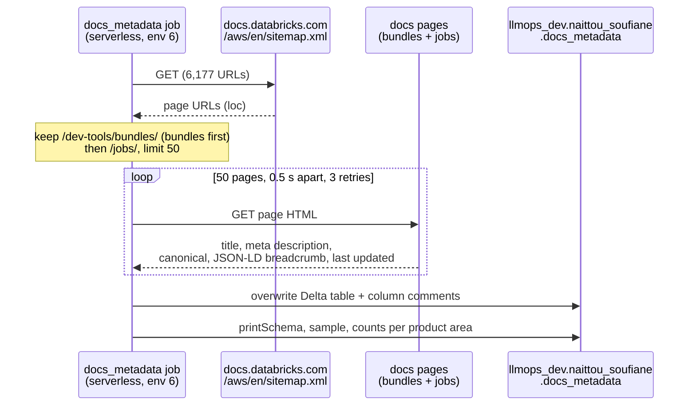
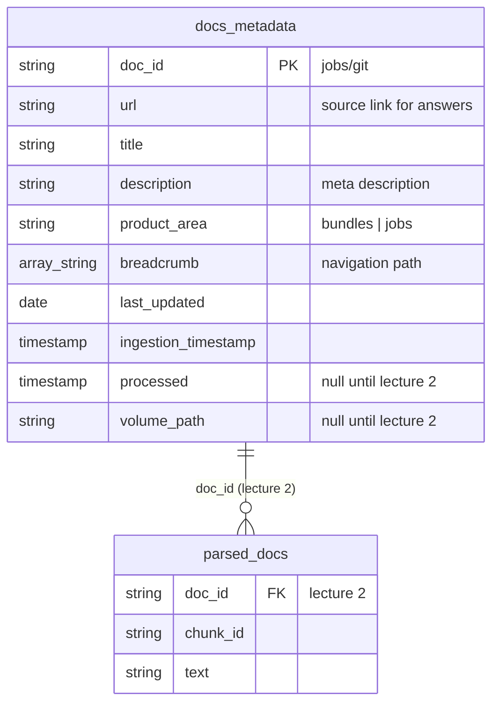
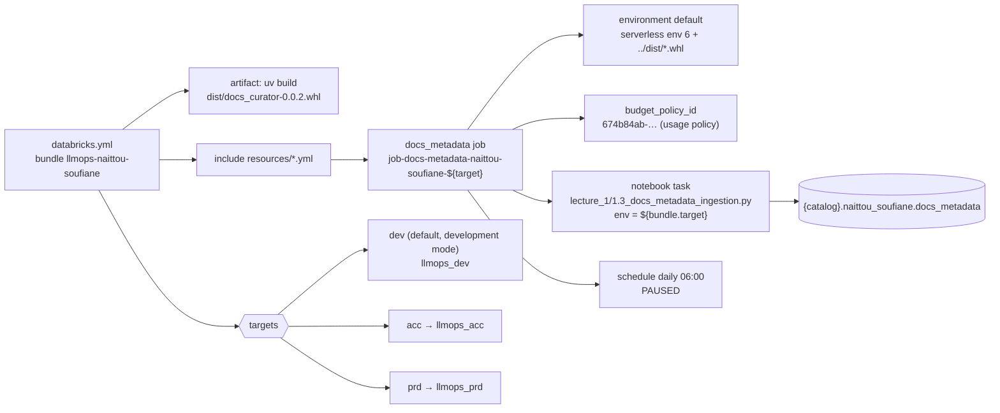

# Lecture 1: docs metadata, bundle job and model service experiments

Lecture 1 builds the "Get docs metadata → Store to delta table" step of [the architecture](architecture.md)
and tries the course chat model on Docs Curator questions.

## Environment

| Setting | Value |
|---|---|
| Python | 3.12 (`requires-python = "==3.12.*"`) |
| Serverless environment | **6**, as in the repo template (`hello` job, `[tool.databricks.environment]`, `databricks-connect~=18.0`). The homework text says 5; I kept 6 to match the provisioned repo. |
| CLI | v1.21.0, profile `llmops-course` (OAuth, `databricks auth describe` checked) |
| Local runs | Databricks Connect with serverless: `DATABRICKS_CONFIG_PROFILE=llmops-course DATABRICKS_SERVERLESS_COMPUTE_ID=auto uv run python <notebook>` |

## Data preparation

### What is fetched, from where



The sitemap carries no `lastmod`, so `last_updated` comes from each page's "Last updated" date. Page bodies
are not read yet: that is "Process doc pages" in lecture 2.

### What is stored



Code: `src/docs_curator/docs_metadata.py` (stdlib parsing + `requests`, tested offline in
`tests/test_docs_metadata.py`), notebook `lecture_1/1.3_docs_metadata_ingestion.py`.

### Result

| product_area | pages | null title/url | null description | last_updated range |
|---|---|---|---|---|
| bundles | 36 | 0 | 0 | 2026-09-11 – 2026-10-15 |
| jobs | 14 | 0 | 0 | 2026-09-11 – 2026-10-15 |
| **total** | **50** | | | |

Sample: `jobs/environment-variables` · "Configure environment variables for serverless jobs" ·
`[Data engineering, Lakeflow Jobs, Configure jobs, Compute, Environment variables]` · 2026-10-15.

## Bundle job



```bash
databricks bundle validate --strict -t dev --profile llmops-course   # Validation OK!
databricks bundle deploy -t dev --profile llmops-course
databricks bundle run docs_metadata -t dev --profile llmops-course
```

Evidence: [run 514668834652773](https://dbc-88df4c2c-4033.cloud.databricks.com/jobs/615488573305297/runs/514668834652773?o=7474648231747660)
of `[dev naittou_soufiane] job-docs-metadata-naittou-soufiane-dev`: `TERMINATED SUCCESS` in about 2 min,
then 50 rows in `llmops_dev.naittou_soufiane.docs_metadata`.

## Model service experiments

`lecture_1/1.4_gateway_experiments.py`: `WorkspaceClient` authenticates and an `OpenAI` client points at
`{host}/ai-gateway/mlflow/v1`. The model is `course_ops.gateway.chat` (served as `gpt-oss-120b-080525`),
with `reasoning_effort="low"` and `max_tokens=1024`.

### Observations and limitations

| prompt | exact prompt sent as the user message | prompt tokens | completion tokens | total | latency | finish | verdict |
|---|---|---|---|---|---|---|---|
| multi_task_job | How do I structure a Databricks Asset Bundle configuration file for a multi-task job where the second task depends on the first? Show the YAML. | 133 | 1024 | 1157 | 6.5 s | `length` | ❌ invalid bundle YAML, truncated |
| zorder | Show me an example of optimizing a Delta table with Z-ordering, and say when liquid clustering is the better choice. | 127 | 1024 | 1151 | 4.8 s | `length` | ⚠️ reasonable, truncated |
| grounded | Using only this documentation page, explain when to use development mode.<br>Title: Declarative Automation Bundles deployment modes<br>Summary: Learn about the syntax and behaviors for declaring and using deployment modes for Declarative Automation Bundles. Bundles enable programmatic management of Databricks workflows.<br>URL: https://docs.databricks.com/aws/en/dev-tools/bundles/deployment-modes<br>Cite the URL in your answer. | 188 | 590 | 778 | 3.1 s | `stop` | ⚠️ cites the URL, invents details |
| recent_change | Databricks Asset Bundles were renamed recently. What is their new name, and since when? | 123 | 252 | 375 | 1.6 s | `stop` | ❌ hallucinated |

Every call also sends the default system prompt of `ProjectConfig` (`src/docs_curator/config.py`): "You are a helpful AI assistant
that helps users find and understand Databricks documentation." The grounded prompt's title, summary and URL
come from the `dev-tools/bundles/deployment-modes` row of `docs_metadata`.

- **Response format**: GPT-OSS returns `message.content` as a **list of parts**, a `reasoning` part
  (with a summary) followed by `text`, instead of a string. The notebook splits them (`split_content`);
  the agent will need the same handling.
- **Invalid bundle YAML**: the multi-task answer names the file `bundle.yaml` (should be `databricks.yml`) and
  puts `jobs:` at the top level (should be under `resources:`). It also invents `bundle.version`, `target:`
  and `task_defaults`, and writes tasks as a map rather than a list. This is exactly the failure the curator
  must fix with retrieval, and later with validation (`databricks bundle validate`).
- **Hallucination on recent facts**: it claimed the bundles were renamed "Databricks Deployments" in June 2024.
  Its reasoning summary shows it was guessing ("Not sure… Let's guess"). The real name is Declarative
  Automation Bundles. The model has no knowledge cutoff guard, so answers must be grounded in the docs.
- **Metadata is not enough grounding**: given only the title and description of the deployment-modes page,
  it cited the URL correctly but invented "lenient validation" and a "Staging" mode. Lecture 2 must retrieve
  page **bodies**, not just metadata.
- **Truncation**: 2 of 4 answers hit `max_tokens=1024` (`finish_reason="length"`). Code-heavy answers
  need a larger budget or a "be concise" system prompt.
- **Cost/latency**: 375–1157 tokens and 1.6–6.5 s per call, within the per-student monthly gateway budget.
