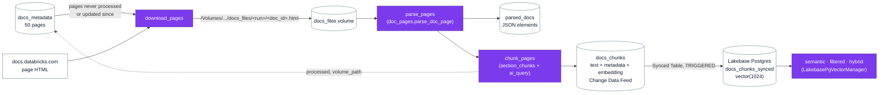

# Lecture 2: retrieval foundation

Lecture 2 builds the "Process doc pages" branch of [the architecture](architecture.md): the 50 pages listed in
`docs_metadata` (lecture 1) become embedded chunks, copied into Lakebase and searched with pgvector.
Databricks AI Search is out of scope.

## What is fetched and stored

| Table | One row per | Key columns |
|---|---|---|
| `parsed_docs` | page | `doc_id`, `path` (raw HTML in the volume), `parsed_content` (JSON elements), `element_count`, `processed` |
| `docs_chunks` | chunk | `id` = `<doc_id>#<n>`, `doc_id`, `section`, `text` (title > section + Markdown body), `has_code`, `product_area`, `title`, `url`, `last_updated`, `embedding` (1,024 floats) |
| `docs_chunks_synced` (Lakebase) | chunk | the same columns, `embedding` as pgvector `vector(1024)`; HNSW cosine index + GIN full-text index |

`docs_metadata` now merges instead of overwriting, so `processed` and `volume_path` survive the daily run, and a
page is processed again only when its `last_updated` date changes.

## Parsing: HTML instead of `ai_parse_document`

`ai_parse_document` reads PDF, image and Office files, not HTML. `docs_curator.doc_pages` reads the page
markup into elements shaped like `ai_parse_document` output (`section_header`, `text`, `code` with its
language, `table` as Markdown, `image` as alt text and URL). The reasons and the risks are in
[the architecture's design decision](architecture.md#design-decision-parsing-html-instead-of-ai_parse_document).

Three bugs were found by checking the first run's output, and are now covered by tests:

| Symptom | Cause | Fix |
|---|---|---|
| Glued and missing paragraphs (jobs/git: 7 of 15 headings) | Minified HTML5 omits `
`, `</li>`, `</td>` | Implied end tags, as the HTML5 rules close them |
| `Supported resources​` in chunks and metadata | The server sends `text/html` without a charset; `requests` decoded UTF-8 as ISO-8859-1 | `fetch_text` decodes as UTF-8 when no charset is sent (also fixes lecture 1 titles) |
| Every table twice; a 2,321-character chunk | A hidden "expand table" dialog repeats each table; tables were never split | Skip `table-expand-card`; split oversized tables between rows, repeating the header |

Result on the 50 pages: 4,028 elements, 236 YAML code blocks. 230 load as YAML; the other 6 are templates with
`{{.project_name}}` placeholders or `...` elisions, or are mis-indented in the docs themselves, and the parser keeps
them exactly as the page shows them.

## Chunking strategies

Default: **section chunks**. A level 1-3 heading starts a chunk, elements are added up to 1,500 characters, code
blocks and tables are only split when one alone is longer (between lines or rows), and each chunk starts with
`<page title> > <section path>`. Alternative: **fixed-size**, 1,000-character windows with 150 characters of
overlap over the page's Markdown (`lecture_2/2.3_chunking_strategies.py`).

| Strategy | Chunks | Avg chars | Median | Min | Max | Over 2,000 | Cut code blocks |
|---|---|---|---|---|---|---|---|
| Section (default) | 823 | 922 | 914 | 81 | 1,621 | 0 | **0** |
| Fixed 1000/150 | 899 | 980 | 1,000 | 174 | 1,000 | 0 | **160** (18%) |

Size distribution of the section chunks: 49 under 250 characters, 129 of 251-500, 278 of 501-1,000, 275 of
1,001-1,500, 92 of 1,501-2,000. Fixed-size chunks are evenly sized but cut 160 code blocks, and a window that
starts mid-page loses which page and section a snippet belongs to. Section chunking stays the default.

## Lakebase Synced Table and search

`lecture_2/2.5_synced_tables.py` enables pgvector (`CREATE EXTENSION vector`), creates the TRIGGERED Synced
Table with `embedding` as `vector(1024)` (later runs start a sync), adds the HNSW and GIN indexes, checks that
Lakebase and Delta both hold 823 rows, then runs three questions three ways, five results each. A hit is a
result whose chunk contains the term the answer needs.

| Expected term | Semantic hits | Filtered hits | Hybrid hits | Semantic top 1 | Hybrid top 1 |
|---|---|---|---|---|---|
| `depends_on` (filter: bundles + code) | 0 | **2** | 1 | `job-task-types#1` | `job-task-types#30` |
| `file arrival` (filter: jobs) | 5 | 5 | 5 | `file-arrival-triggers#4` | `file-arrival-triggers#12` |
| `mode: development` (filter: bundles) | 1 | 1 | **2** | `reference#33` | **`deployment-modes#1`** |

What changed:

- **Filtering** only changes the results when the filter excludes some of them. Restricting the first question to
  code chunks brought in two `depends_on` YAML examples that semantic search missed. The `product_area` filters
  changed nothing, because the best results were already in that area.
- **Hybrid search first changed nothing.** `plainto_tsquery` requires every term of the question; no chunk
  contains them all, so every text score was 0 and hybrid returned the semantic ranking at 0.7×. Combining the
  terms with OR and normalizing `ts_rank_cd` to 0-1 fixed it: hybrid now replaces 2 of the 5 results for every
  question, and puts the right page first for the exact-identifier question (`deployment-modes#1`, which contains
  `mode: development` and the `[dev ...]` prefix).
- **Vocabulary gap.** "depend on the first one" doesn't retrieve the `depends_on` key: the embedding doesn't link the
  phrase to the YAML key, and full-text search reduces `depends_on` to `depend`, which also matches every prose
  chunk saying "depends on", so it doesn't rank the YAML higher. Query rewriting toward config keys,
  or the agent asking for code chunks, are options for the agent lectures.

## Bundle

| Job | Tasks |
|---|---|
| `job-docs-metadata-naittou-soufiane-<target>` (daily, paused) | `docs_metadata_ingestion` (1.3) → `process_doc_pages` (2.2) |
| `job-docs-synced-tables-naittou-soufiane-<target>` | `lakebase_synced_tables` (2.5) |

Evidence (dev):
- pipeline run [984730889248265](https://dbc-88df4c2c-4033.cloud.databricks.com/jobs/615488573305297/runs/984730889248265?o=7474648231747660), `TERMINATED SUCCESS`: 50 pages processed, 823 chunks, 0 missing embeddings
- Synced Table run [828867651796420](https://dbc-88df4c2c-4033.cloud.databricks.com/jobs/913806316634654/runs/828867651796420?o=7474648231747660), `TERMINATED SUCCESS`: sync completed, 823 rows in Delta and Lakebase
- `pytest`: 23 passed

## Configuration changes

- `embedding_endpoint`: `databricks-gte-large-en`. `ai_query` doesn't support custom Unity Gateway model
  services such as `course_ops.gateway.embed` yet; both serve GTE Large (1,024 dimensions).
- `lakebase_instance` → `lakebase_project_id`, as in the course code; `usage_policy_id` is now loaded into
  `ProjectConfig` (the Synced Table's pipeline needs it).
