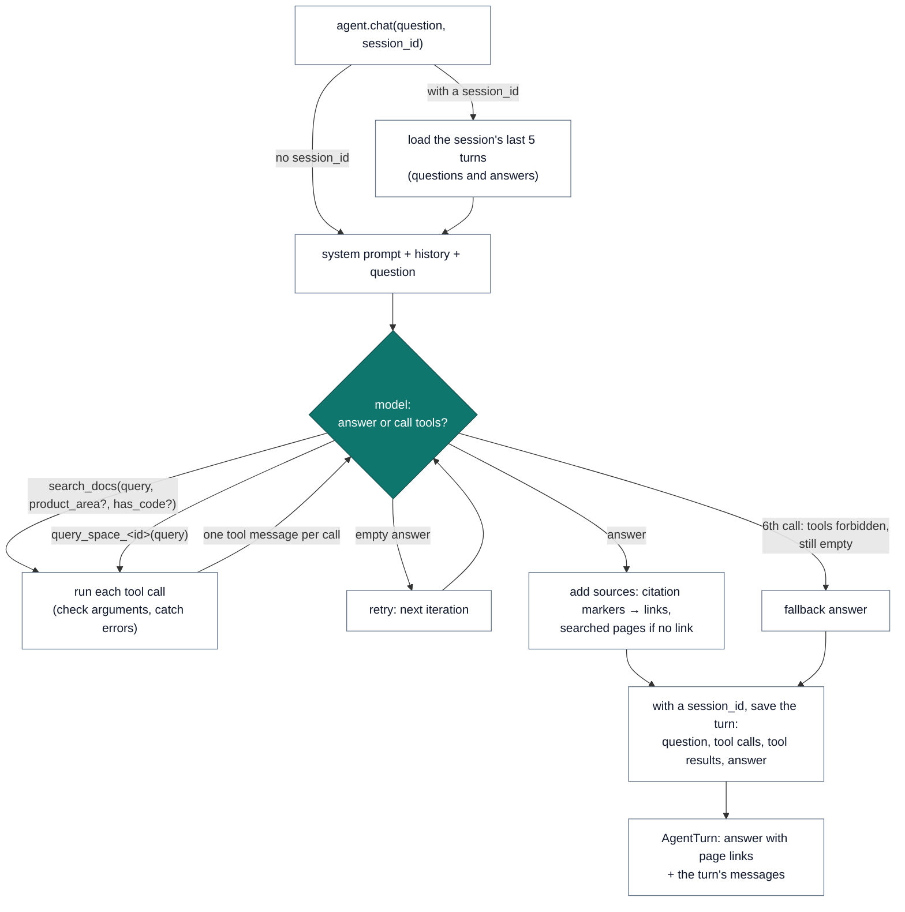
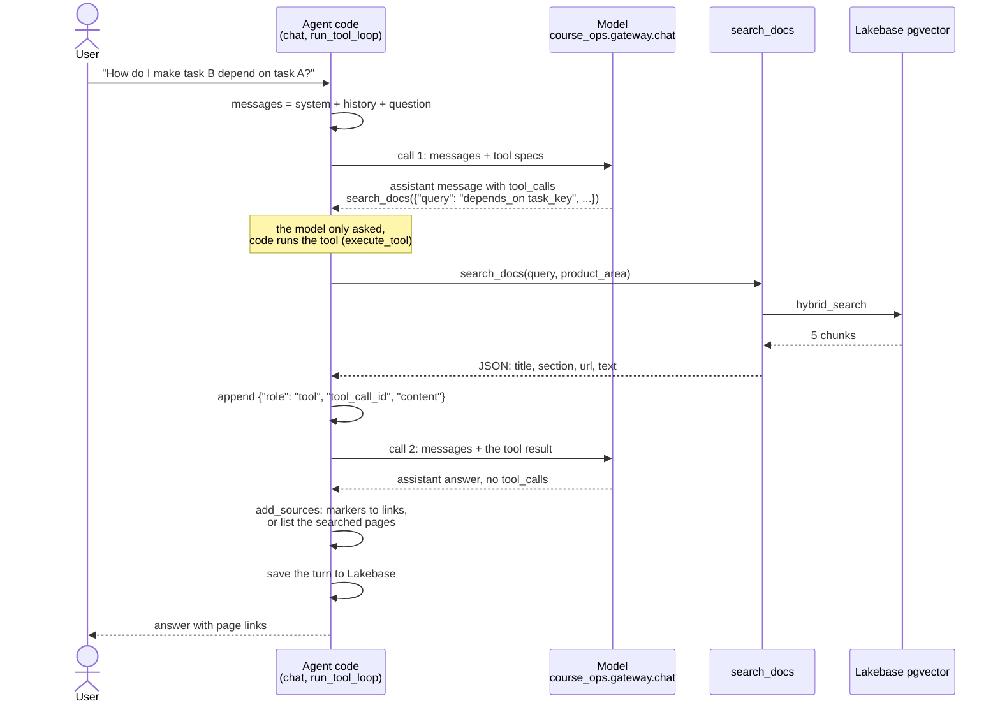
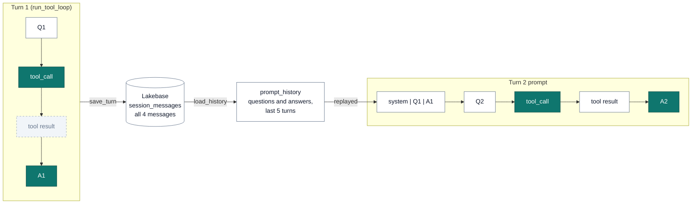

# Lecture 3: tools, orchestration and memory

Lecture 3 builds the "Agent" group of [the architecture](architecture.md): an LLM that decides when to search
the documentation and when to ask Genie about the page catalog, and that keeps a conversation in Lakebase.

## 1. Tools for the use case

The users ask two kinds of question, and each needs its own tool:

| Question | Example | Data | Tool | Kind |
|---|---|---|---|---|
| What the docs say | "How do I make a task depend on another in a bundle?" | `docs_chunks_synced` (Lakebase pgvector, lecture 2) | `search_docs` | Custom function |
| Which pages exist | "Which bundles pages changed recently?" | `docs_metadata` (Delta, lecture 1) | `query_space_<id>`, `poll_response_<id>` | Managed MCP (Genie) |

- **`search_docs` is a custom function.** No managed MCP server serves Lakebase pgvector (the managed ones are
  AI Search, Genie, UC functions and DBSQL), and the tool needs our own logic: hybrid ranking, the
  `product_area` and `has_code` filters, the argument checks. Its contract is narrow: a query and optional
  filters in, sections with title, section, URL and full text out (`docs_curator.tools`). No SQL, no credentials.
- **Genie is managed MCP.** Catalog questions are SQL over one table, which Genie writes and runs; its MCP server
  needs no code of ours. The space (`docs_curator.genie`) has the table with its column comments, instructions
  (return `url` with every page, "recently updated" means by `last_updated`, the table has no page content),
  three sample questions and one example SQL. It is created once per catalog and found again by title.
- **Not tools.** Loading and saving memory, and the YAML check the MVP asks for, are steps that must always
  happen, so code runs them. The YAML check is left for the evaluation lecture.

## 2. Orchestration: what code decides, what the model decides



| Code (deterministic, testable) | Model (`course_ops.gateway.chat`, GPT-OSS 120B) |
|---|---|
| Which tools exist and their contracts | Whether a question needs a tool at all (greetings don't) |
| Load the last 5 turns, save every turn | Which tool: content (`search_docs`) or catalog (Genie) |
| Check arguments: empty query, unknown `product_area`, `num_results` clamped to 1-10 | The search terms, rewritten toward config keys (`depends_on`) |
| A failing tool, unknown tool or bad JSON becomes an error output the model reads | The filters: `product_area`, `has_code` |
| Six model calls per turn at most; the last may not call tools | Whether to search again after weak results |
| Retry an empty answer; fall back to a fixed answer | The answer, its YAML and its links |
| Turn citation markers into links; list the searched pages when the answer links to none | |
| Compact Genie's response before the model sees it | |

This is a small agent inside a fixed frame: the model controls the steps that depend on the question, and code
controls everything that must hold for every question. `docs_curator.agent.DocsCuratorAgent` is a plain
chat-completions tool loop (one `tool` message per call, all calls of a message run) inside that frame;
`agent.chat(question, session_id)` answers one question. MLflow (`ResponsesAgent`, tracing) is not used yet: it
belongs to the architecture's "Deploy the agent" and "Monitor" blocks.

### One turn, message by message

The model never runs anything, and the agent doesn't call itself. When the model needs data it answers with a
request, an assistant message with `tool_calls`, which is only JSON text. The code in `run_tool_loop`
(`src/docs_curator/agent.py`) reads it, runs the tool, appends the result as a `tool` message, and calls the model
again with the longer conversation. The loop ends when the model answers without `tool_calls`.



The messages of that turn, in order:

```python
# 1. what chat() sends on call 1
[
    {"role": "system", "content": SYSTEM_PROMPT},
    {"role": "user", "content": "How do I make task B depend on task A in a bundle?"},
]

# 2. call 1 returns a request, not an answer
{
    "role": "assistant",
    "content": "",
    "tool_calls": [
        {
            "id": "call_1",
            "type": "function",
            "function": {
                "name": "search_docs",
                "arguments": '{"query": "depends_on task_key", "product_area": "bundles"}',
            },
        }
    ],
}

# 3. code runs search_docs and appends its result, tied to the call's id
{
    "role": "tool",
    "tool_call_id": "call_1",
    "content": '[{"title": "Add tasks to jobs in Declarative Automation Bundles", '
    '"url": "https://docs.databricks.com/aws/en/dev-tools/bundles/job-task-types", '
    '"text": "... depends_on:\\n  - task_key: task_a ..."}]',
}

# 4. call 2 (messages 1 + 2 + 3) returns the answer; add_sources appends the pages if it links to none
{
    "role": "assistant",
    "content": "Add depends_on to task B: ...\n\nPages searched for this answer:\n"
    "- [Add tasks to jobs in Declarative Automation Bundles](https://docs.databricks.com/aws/en/dev-tools/bundles/job-task-types)",
}
```

The loop's guards:

| Case | What the code does |
|---|---|
| Several tool calls in one message | Runs them all, one `tool` message per `tool_call_id` |
| The tool fails, the tool is unknown, or the arguments aren't JSON | The `tool` message holds `{"error": "..."}`; the model can retry or say so |
| Empty answer (GPT-OSS stops with no text and no call) | `call_llm` returns `None`; the next iteration asks again |
| 6th model call (`max_iterations`) | Sent with `tool_choice="none"`, so the model has to answer |
| Still no answer | `FALLBACK_ANSWER` |

### Workflow against agent (`lecture_3/3.1_docs_tools.py`)

The same four questions through a fixed RAG workflow (one hybrid search on the question, then one model call)
and through the agent with `search_docs` only:

| Question | Workflow searches | Agent searches | Agent filters | Workflow links | Agent links |
|---|---|---|---|---|---|
| Hi! What can you help me with? | 1 | **0** | | 5 | 0 |
| Make the second task depend on the first (YAML) | 1 | 1 | bundles, code | 1 | 2 |
| Run a job when new files arrive in a volume | 1 | 1 | jobs, code | 6 | 3 |
| What does `mode: development` change? | 1 | 1 | bundles | 5 | 1 |

- The agent **skips retrieval when none is needed**: the workflow searched for "Hi!" and answered with five
  unrelated links.
- It **rewrites the question and filters**: "depends_on second task first task bundle" with `bundles` + `has_code`,
  where the workflow searches the user's words.
- It **searches again** when the first results fall short: in an earlier run the `mode: development` question took
  a second search with 10 results.
- Its cost is variance: the same question can take one or four searches, and filters it chooses can hide the
  answer (section 5).

## 3. Genie through managed MCP (`lecture_3/3.2_genie_mcp.py`)

The space id is `genie_space_id` in `project_config.yml` (dev only: the acc and prd `docs_metadata` tables are
written by the acc and prd deployments, which don't run yet). Its server, `/api/2.0/mcp/genie/{space_id}`, exposes
`query_space_<id>` and `poll_response_<id>`. `create_mcp_tools` keeps their names, descriptions and input
schemas, so the agent calls them like `search_docs`.

Genie's answer carries the full statement result: manifest, chunk counts, typed values, suggested questions.
`compact_genie_response` keeps the status, ids, text, SQL, columns and rows, which matters because the output
is resent with every later model call of the turn. On "How many pages are there per product area?" the response
drops from 1,629 to 642 characters (−61%).

With both tools the model routes as intended: "Which bundles pages were updated most recently?" goes to Genie and
comes back as a table of linked pages; "Which jobs pages talk about triggers, and how do I set a file arrival
trigger?" goes to `search_docs`.

## 4. Session memory in Lakebase (`lecture_3/3.3_session_memory.py`)

| Table | One row per | Columns |
|---|---|---|
| `"llmops_dev_memory".session_messages` (Lakebase) | chat message: question, assistant tool call, tool result, answer | `id` (BIGSERIAL), `session_id`, `message_data` (JSONB), `created_at`; index on `(session_id, id)` |

- **One Postgres schema per catalog** (`<catalog>_memory`): dev, acc and prd share the Lakebase project.
- **Ordered by `id`, not `created_at`.** The messages of a turn are inserted in one transaction and share its
  `created_at`, so ordering by time would leave their order undefined.
- **Everything is stored, questions and answers are replayed** (below).
- **Memory never fails a turn.** A load error answers without history, a save error is logged.
- **A connection per call**, with a fresh credential (`docs_curator.lakebase`, shared with pgvector search):
  Lakebase credentials expire after an hour, which a long-lived pool would hit.

Three requests, each by a new agent instance, so the context can only come from Lakebase. The follow-ups ("that
job", "its tasks") resolve: the second answer keeps the `depends_on` tasks of the first, the third explains what
development mode does to the job's schedules and triggers.

| | Messages | Bytes |
|---|---|---|
| Stored for the session (3 turns) | 14: 3 questions, 4 tool calls, 4 tool results, 3 answers | 37,844 |
| Replayed in the next prompt | 6: questions and answers | 6,147 (−84%) |

### What the model sees, turn by turn

Tool results reach the model within the turn that searched; from the next turn on, only questions and answers do.
Within a turn every tool result is in `messages`, since the model called the tool to read it. A new turn starts
`messages` again from the system prompt, the history loaded from Lakebase and the question, and `prompt_history`
keeps only questions and assistant answers without `tool_calls`.

```text
Turn 1  call 1  system | Q1
        call 2  system | Q1 | tool_call search_docs | tool result (8 KB)        → A1
        saved   Q1 | tool_call | tool result | A1                                (all 4, in Lakebase)

Turn 2  call 1  system | Q1 | A1 | Q2                                             (turn 1's tool messages left out)
        call 2  system | Q1 | A1 | Q2 | tool_call search_docs | tool result      → A2
```

The model resolves "that job" in Q2 from A1, which already has the YAML and the links. It can't quote turn 1's
search results word for word; a follow-up that needs them searches again.



### Stored, replayed, shown

| Layer | Holds | Read by |
|---|---|---|
| Lakebase `session_messages` | everything: questions, tool calls, tool results, answers | us: inspecting a conversation; evaluation later |
| The next prompt (`prompt_history`) | questions and answers of the last 5 turns | the model |
| A chat UI (the architecture's Databricks app) | questions and answers, with the links `add_sources` guarantees; never the raw `role: tool` JSON | the user |

- **Why store tool calls and results:** until MLflow tracing is added, the table is the only record of
  what the agent searched, with which filters, and what came back (that is how the `has_code` problem of section 5
  was found). Evaluating groundedness also needs the retrieved context, not only the answer. The cost is size: tool
  results are 30.7 of the session's 37.8 KB (81%).
- **Why not replay them:** up to 8 KB per search would crowd every later prompt, the answers already carry the
  links, and the chat API accepts a `tool` message only after the assistant message holding its `tool_calls` id, so
  they would go back in pairs or not at all.
- **Once MLflow tracing is added**, traces keep every tool call and result; memory can then shrink to the
  conversation itself.

## 5. What the first runs showed

Found by running the agent against dev, fixed, and covered by `tests/test_agent.py` and `tests/test_tools.py`:

| Symptom | Cause | Fix |
|---|---|---|
| Empty answer to "Which bundles pages were updated most recently?" after two turns | GPT-OSS stops with a reasoning summary and no text or tool call: 2 of 4 identical calls | An empty answer doesn't end the turn: the call is retried, and the last iteration falls back to a fixed answer |
| Citations as `【dev-tools/bundles/job-task-types#17】`, then `【0†L9-L19】`: 0 links in 4 agent answers | GPT-OSS cites like its browsing tool, whatever the prompt asks | `search_docs` no longer returns the chunk id; code turns `【https://…】` into links, drops the others, and lists the searched pages when an answer has no link (`answer_checks.add_sources`) |
| GPT-OSS answers as a list of parts | Reasoning and text parts instead of a string (lecture 1) | `message_text` keeps the text parts |
| `asyncio.run() cannot be called from a running event loop` in 3.2 on serverless | The MCP client runs asyncio inside the notebook's loop | `nest_asyncio.apply()` before the first MCP call |
| A redeploy ran the previous code | Serverless reuses the environment of an unchanged wheel path (`docs_curator-0.0.4-…whl`) | `dynamic_version: true` on the bundle artifact adds the build time to the version |

### Still open: invented YAML

Asked for a file-arrival trigger in a bundle, the agent wrote YAML the docs don't show, different in each run:
`schedule: trigger: file_arrival: path:`, then `schedule: trigger_type: file_arrival:`, then
`triggers: file_arrival: url:`.

What the docs hold: the bundles resource reference lists two job keys, `job.trigger` (a map,
`dev-tools/bundles/resources#112`) and `job.triggers` (a list, CLI 1.13.0+, `#114`), both with `file_arrival` as a
"Map" and "See file_arrival" for its fields. That sub-table isn't in our 50 pages, and no chunk of the 823 has
`file_arrival:` written as YAML. The last variant is close: `triggers` exists, but as a list
(`triggers: - file_arrival:`), and `url` can't be checked against our pages.

Three gaps add up:

1. **No example in the knowledge base.** The reference tables name the keys but not their fields, and the jobs page
   describes the UI ("In Storage location, enter the URL…"), not YAML.
2. **Retrieval hides the reference tables.** They have `has_code = false`, and the model almost always searches with
   `has_code: true` when a YAML answer is asked for.
3. **The model fills the gap** with a plausible shape instead of saying it isn't documented: the UI's wording
   (`path`), the job's `schedule` block it did retrieve, and what it remembers of the Jobs API (`url`). The prompt
   rule that every key must come from a tool result isn't enforced in code.

Telling it about `has_code` in the prompt and in the tool's parameter description helped once in two reruns. Open
fixes: keep `has_code` from hiding the reference tables, and add the pages holding the `file_arrival` fields and
bundle examples.

**Tried and removed: a YAML check in the loop.** Code compared each key of an answer's YAML blocks with the
turn's tool outputs and sent the answer back once with the missing keys named. It caught the invented keys,
but in two reruns of the conversation both follow-ups ended on the fallback answer: it also flagged names the
user picks (`my_job`) and keys found in earlier turns (`depends_on`, whose search outputs are not replayed), and
the extra round used up the six model calls. A check that turns usable answers into "I couldn't answer" costs
more than it saves. Checking YAML keys against the retrieved context belongs in the evaluation lecture, as a
scorer over traces, where its false positives don't reach users; the prompt rule stays.

## Bundle

| Job | Tasks |
|---|---|
| `job-docs-agent-tools-naittou-soufiane-<target>` | `docs_tools` (3.1) → `genie_mcp` (3.2) → `session_memory` (3.3), one after another for the gateway's rate limits |

Evidence (dev):
- job run [320592848402734](https://dbc-88df4c2c-4033.cloud.databricks.com/?o=7474648231747660#job/627962972984092/run/320592848402734),
  `TERMINATED SUCCESS`: the three tasks
- Genie space `01f1d5d1b11d143bbcfe7aaa526de9fd` (`docs-curator llmops_dev.naittou_soufiane`)
- Lakebase table `"llmops_dev_memory".session_messages`
- `pytest`: 51 passed. A first run's `docs_tools` task aborted importing psycopg's libpq (SIGABRT) and succeeded
  on the automatic retry; it hasn't happened again.

## Not done here

- **Service principal for Lakebase**: the agent connects as whoever runs it. A serving endpoint needs its own
  Postgres role, set up when the agent is deployed.
- **UC functions as tools**: no tool of the use case needs one yet.
- **MLflow** (`ResponsesAgent`, tracing, logging and registering the agent): part of the architecture's "Deploy
  the agent" and "Monitor" blocks.
