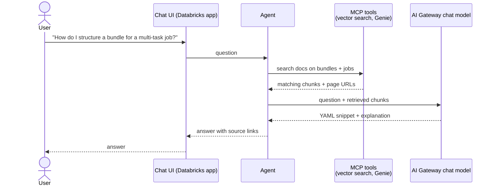

# Use case: Databricks Docs Curator

## Users and problem

Data engineers, data scientists and platform administrators who build on Databricks. The documentation they
need is spread across hundreds of pages, and getting a bundle or job configuration right often means
cross-reading several of them. The curator answers natural-language questions with valid code snippets and
links to the pages it used.

## Data

| Source | Use |
|---|---|
| Public docs pages under `docs.databricks.com/aws/en/dev-tools/bundles/` and `/jobs/`, found through the [sitemap](https://docs.databricks.com/aws/en/sitemap.xml) | Knowledge base and source links |
| Later: PySpark and Delta Lake API references, the [bundle-examples](https://github.com/databricks/bundle-examples) templates | Wider coverage, more example YAML |

## Example interactions

Other examples: "Show me an example of optimizing a Delta table with Z-ordering", "How do I pass a task
value to a downstream task?"

## MVP scope

- Knowledge base limited to Declarative Automation Bundles and Lakeflow Jobs.
- 50 documentation pages: all bundles pages first, then jobs pages.
- Answers must cite page URLs; YAML snippets must be valid against the bundle schema.
